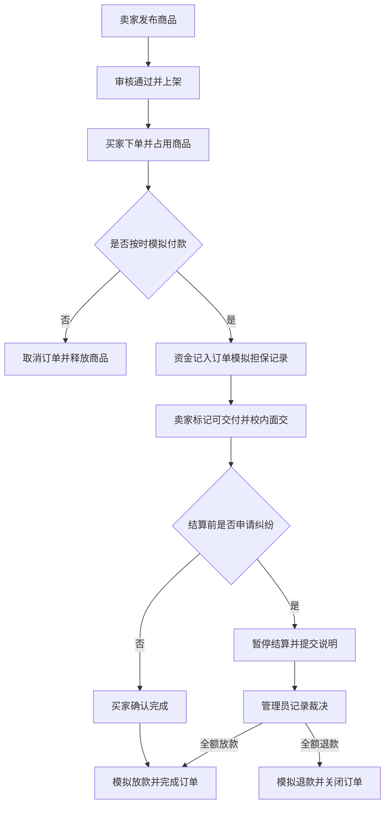

# 校园二手交易与担保履约平台

> 《微服务开发与实践》课程项目 · 程悠洋 · 2412190609

## 项目简介

本项目面向校内学生，提供闲置商品发布、下单、校内面交和模拟担保结算功能，帮助买卖双方记录交易过程，并通过明确的订单状态和简单纠纷处理协调交付与结算。本学期持续使用本仓库，先实现模块化单体，再按课程要求逐步增加认证、消息、服务拆分、监控和部署能力。

**当前阶段：第六周微服务拆分。用户、商品、订单三个独立服务通过 HTTP 协作；单体版本保留在 monolith。支付、登录、面交和纠纷仍为后续设计目标。**
## 业务背景与目标用户

学生在毕业、搬宿舍或更换学习用品时，经常需要转让教材、数码配件及生活用品。通过群聊交流时，商品是否已经售出、双方是否约定交付、交易是否结束等信息容易分散，出现争议时也缺少统一记录。本项目以单一校园内的二手交易为场景，用商品状态、订单记录和模拟担保结算串联交易，探索如何让交易过程可查询、可追踪、可恢复。

| 目标用户／角色 | 主要需求与权限 |
| --- | --- |
| 学生卖家 | 发布和下架自己的闲置商品，查看自己的销售订单，标记可交付并提交纠纷说明 |
| 学生买家 | 浏览商品、下单、模拟付款、确认面交完成，查询自己的订单并申请纠纷处理 |
| 平台管理员 | 审核商品、查看待处理纠纷、记录裁决理由，管理账号状态并查询操作记录 |

买家与卖家是同一个学生账号在不同交易中的身份，不要求注册两套账号。第一版将审核、纠纷处理和平台管理放在一个管理后台；管理员不能参与处理自己的交易纠纷。用户只能操作与自己有关的商品和订单，权限校验由后端执行。

## 项目目标与选题理由

1. 建立“发布—下单—模拟担保—面交—确认—放款”的完整闭环，避免只做商品信息的增删改查。
2. 用有限、可测试的规则处理商品重复购买、未付款超时取消以及结算前纠纷。
3. 围绕真实业务问题学习数据库、认证权限、消息、事务一致性和部署，而非一开始按数据表机械拆服务。

选择该题目，是因为校园交易场景容易理解，同时商品唯一占用、订单状态变化和模拟资金结算具有足够的技术挑战。

## 功能模块与交付范围

| 模块 | 具体功能 | 计划范围 |
| --- | --- | --- |
| 用户与权限 | 注册、登录、密码安全存储、学生／管理员权限、本人资源访问控制 | 第一版 |
| 商品 | 标题、描述、价格、分类和图片；发布、列表、详情；未占用商品下架 | 第一版 |
| 商品审核 | 管理员通过／驳回，记录理由；只有审核通过的商品可购买 | 本学期补齐，第一版可先简化 |
| 订单与面交 | 下单、商品占用、卖家标记可交付、买家确认完成、订单查询 | 第一版 |
| 模拟担保结算 | 每笔订单的模拟付款、担保金额、放款记录；避免重复处理 | 第一版完成正常流程，本学期补齐异常处理 |
| 取消与纠纷 | 未付款超时取消、释放占用；结算前提交纠纷说明；管理员全额退款或放款 | 本学期补齐 |
| 通知与审计 | 订单状态站内通知、失败重试；记录关键操作及裁决理由 | 本学期补齐 |
| 评价与收藏 | 成交后评价、商品收藏 | 时间充裕再做，不阻塞核心验收 |

## 核心业务流程

以下图中的“付款”和“放款”都是模拟台账变化。简化审核可以在第一版使用后台操作完成。



### 关键业务规则

- **单件交易：**每条商品记录代表一件闲置，一笔订单只购买一件商品；固定价格、不议价、不合单。禁止购买自己的商品。
- **唯一占用：**同一商品同一时刻只能被一个有效订单占用；下单时保存价格和商品描述快照，商品后续修改不能改变历史订单金额。
- **未付款取消：**超时前未付款的订单取消并释放占用。支付与超时并发时必须校验当前状态；取消后到达的付款结果不能直接恢复订单，进入模拟退款或待处理流程。
- **交付和确认：**本学期仅支持校内面交。卖家标记可交付后，由买家确认完成；不做自动确认收货。买家长期不确认时由管理员按纠纷规则处理。
- **结算前纠纷：**付款后、结算前可申请；申请成功后暂停放款。买家确认与纠纷申请竞争时只能接受一个有效状态转换。
- **有限裁决：**只支持全额退款或全额放款，不做部分退款、多轮申诉和结算后追偿。涉及实物退回时，管理员在记录交接说明后再裁决；系统不自动判断实物是否退回。
- **商品恢复：**未付款取消可自动恢复可售；付款后退款不自动上架，避免商品已经交付却被再次出售，需卖家核实后重新发布。
- **模拟资金：**只记录订单担保金额，不做充值、提现或通用钱包。退款和放款不得重复执行，且不可对同一笔担保同时全额执行。
- **基本核对：**不考虑手续费时，每笔订单的累计担保入账应等于当前担保余额、累计退款和累计放款之和；记录必须可追踪，金额不得为负。
- **权限：**买家、卖家和管理员只能执行各自允许的状态转换。隐藏页面按钮不能代替后端权限校验。

## 当前范围与暂不实现的内容

本学期以单校园、学生个人闲置、固定价格、单件订单、面交和模拟资金为边界。第一版只保证正常交易闭环；超时取消、简单纠纷、可靠消息和服务拆分分阶段增加。

暂不接入真实支付和真实身份核验服务；注册登录及角色权限属于本学期范围。暂不实现物流配送、通用钱包、拍卖、跨校交易、实时聊天、推荐算法和信用评分。这些功能会增加渠道接入、数据需求或业务分支，不作为本学期验收承诺。平台仅记录教学模拟交易，不声称能够消除现实交易风险。

## 技术演进方向

计划使用 Java / Spring Boot、关系型数据库和网页界面。先做模块化单体，不在选题阶段固定所有框架版本；实现前再核对兼容性。消息队列只选择一种，部署采用本地 Docker Compose。

| 课程能力 | 本项目中的具体应用 |
| --- | --- |
| 数据库持久化 | 保存用户、商品、订单、担保记录和纠纷；用约束与事务维护唯一占用 |
| 认证与权限 | 登录认证、管理员权限、买卖双方对本人资源的访问控制 |
| 并发与本地事务 | 防止同一商品被重复购买，校验订单状态，保护担保结算记录 |
| 消息 | 订单变更后发送站内通知，处理重复消息和发送失败 |
| 跨服务一致性 | 先选一条订单与结算流程，明确中间状态、重试、幂等及异常核对 |
| 监控 | 健康检查、请求／订单关联日志、待处理结算和消息失败指标 |
| 部署 | Docker Compose 启动服务、数据库及消息队列，提供演示数据和运行说明 |

单体稳定后，按课程进度逐步拆分为最多三个业务服务：

| 服务 | 数据与职责边界 |
| --- | --- |
| 用户与商品服务 | 用户认证资料、商品发布审核、商品占用与售出状态 |
| 交易履约服务 | 订单、面交、纠纷、裁决；决定是否具备结算条件 |
| 担保结算服务 | 模拟入账、冻结、退款、放款及核对；保证资金操作不重复 |

服务之间通过接口或事件交互，不直接修改对方的数据表。初期可共用一个数据库实例，但拆分后各服务拥有独立的数据范围。通知先作为内部模块，不为增加服务数量单独拆分。

## 16 周计划

| 阶段 | 计划成果 |
| --- | --- |
| 第 1—2 周 | 环境准备、唯一选题、README、业务规则与功能规划；第一周记录见下方链接 |
| 第 3—4 周 | 数据模型、登录、商品发布查询、最小网页界面 |
| 第 5—6 周 | 下单占用、模拟担保付款、面交确认和放款，演示正常闭环 |
| 第 7—8 周 | 简单审核、超时取消、纠纷及全额退款／放款 |
| 第 9—10 周 | 关键权限、并发、重复请求测试；明确模块接口并开始拆分 |
| 第 11—12 周 | 最多三个业务服务、可靠消息、失败重试与一致性核对 |
| 第 13—14 周 | 基础监控、Docker Compose、演示数据及运行文档 |
| 第 15—16 周 | 集成验收、缺陷修复、截图和课程展示，不再新增大模块 |

这是计划而非已完成功能清单。若进度不足，先取消评价、收藏、统计及界面美化，优先保证闭环、权限、关键异常处理和课程必需技术任务；必要时结合老师实际授课安排调整周次。

## 计划验收场景

1. 完成一笔发布、下单、付款、面交、确认和放款的模拟交易。
2. 两名买家同时下单同一商品，最多一个成功占用。
3. 未付款订单超时后释放商品；迟到付款结果不会使已取消订单恢复。
4. 对付款或放款操作重复提交，不会出现重复入账或重复放款。
5. 申请纠纷后阻止普通放款；裁决只执行一次，并记录理由。
6. 用户无法查看或修改其他无关用户的订单及纠纷材料。
7. 消息处理失败后可以重试，重复消息不会造成重复业务变更。


## 第三周：运行与测试说明

当前已实现 Spring Boot 启动、基础 YAML 配置、问候 GET 接口、Actuator 健康检查和应用上下文启动测试。上文交易功能为学期规划；尚未实现注册登录、商品和订单 CRUD、担保结算、Service、Repository 或数据库。

### 环境与目录

- Java：JDK 25；本机验证版本为 Temurin 25.0.4.1。
- Spring Boot：4.0.8；Group 与包名：com.zjgsu.cyy。
- Maven：使用工程自带 Maven Wrapper，配置下载 Maven 3.9.16，无需单独全局安装 Maven。
- 完整工程位于 monolith/；pom.xml 与 src/ 同属此 Maven 工程。
- 配置文件：monolith/src/main/resources/application.yml；默认端口 8080。

### 通用命令

先确保 JAVA_HOME 指向 JDK 25。以下命令从仓库根目录开始，Linux／WSL 使用对应平台的 JDK：

```bash
cd monolith
./mvnw test
./mvnw spring-boot:run
```

若 Linux 解压后提示无执行权限，先执行 `chmod +x mvnw`。Windows CMD 使用 `mvnw.cmd test` 和 `mvnw.cmd spring-boot:run`；PowerShell／Git Bash 使用 `./mvnw.cmd test` 和 `./mvnw.cmd spring-boot:run`。

### 本机 Windows Git Bash：D 盘缓存

在 VS Code 的 Git Bash 中，从仓库根目录执行以下配置。路径为本机示例，其他电脑应替换为实际 JDK 与缓存位置；每个新终端需重新设置。

```bash
mkdir -p /d/codexwork/maven-cache/repository /d/codexwork/maven-cache/tmp
export JAVA_HOME='D:/codexwork/Applications/Java/jdk-25.0.4.1+1'
export MAVEN_USER_HOME='D:/codexwork/maven-cache'
export MAVEN_OPTS='-Dmaven.repo.local=D:/codexwork/maven-cache/repository -Djava.io.tmpdir=D:/codexwork/maven-cache/tmp'
export TEMP='D:/codexwork/maven-cache/tmp'
export TMP='D:/codexwork/maven-cache/tmp'
cd monolith
./mvnw.cmd test
./mvnw.cmd spring-boot:run
```

Maven Wrapper 下载与依赖缓存放在 D 盘，编译输出在 monolith/target/，不提交 target。运行时保持终端打开，停止使用 Ctrl+C。如果端口被旧程序占用，先停止旧实例，不要同时启动两个应用。

### 验证地址

- http://localhost:8080/api/hello ：返回“你好，校园二手交易与担保履约平台！”。
- http://localhost:8080/actuator/health ：返回 JSON，status 应为 UP，可能附带其他健康信息字段。
- contextLoads 测试结果以 Tests run、Failures、Errors 和 BUILD SUCCESS 为判断依据。

详细记录见[第三周作业](docs/homework/week-03/index.md)，选题衔接见[项目规划](docs/project-proposal.md)。


## 第四周：商品与订单持久化（本机 Java 启动方式）

第三周的命令记录保留供历史参考。当前启动前必须配置 MySQL；自动化测试独立使用 H2，不需要先启动 MySQL。

### MySQL 安装与建库

从 [MySQL 官方](https://dev.mysql.com/downloads/mysql/8.4.html) 下载 Windows ZIP，解压到非 C 盘目录。采用独立配置文件指定 basedir、datadir、tmpdir 和端口，用 mysqld 初始化数据目录并设置管理员密码，再启动实例。本机使用 MySQL 8.4.11，程序位于 D:/codexwork/Applications/mysql-8.4.11-winx64，数据位于 D:/codexwork/mysql-campus-trade/data，仅监听 127.0.0.1:3307，避免与已有 MySQL 8.0 冲突。

其他电脑可用本地已有的 MySQL 8.4，管理员执行以下 SQL；请替换示例密码：

```sql
CREATE DATABASE IF NOT EXISTS campus_trade CHARACTER SET utf8mb4;
CREATE USER IF NOT EXISTS 'campus_trade'@'localhost' IDENTIFIED BY 'replace-with-your-password';
GRANT ALL PRIVILEGES ON campus_trade.* TO 'campus_trade'@'localhost';
```

已有同名用户时应使用实际密码，CREATE USER IF NOT EXISTS 不会修改旧密码。

### 启动与测试

在已配置 Java 25 和 Maven 缓存的 Git Bash 中，从仓库根目录执行：

```bash
cd monolith
./mvnw.cmd test
export DB_URL='jdbc:mysql://127.0.0.1:3307/campus_trade?connectionTimeZone=UTC'
export DB_USER='campus_trade'
read -s -p 'MySQL password: ' DB_PASSWORD; echo
export DB_PASSWORD
./mvnw.cmd spring-boot:run
```

Linux/macOS 使用 `./mvnw`。数据库端口若为 3306，请修改 DB_URL。应用默认端口为 8080；先停止旧应用再启动。密码不要写入 Git。

本机另有仓库外辅助脚本 `D:/codexwork/start-campus-trade.ps1`，会启动 D 盘数据库并读取本地凭据；其他电脑不依赖该脚本。PowerShell 执行 `& 'D:/codexwork/start-campus-trade.ps1'`。

### 可直接执行的请求示例

应用启动后，在 Git Bash 执行：

```bash
curl -i -X POST 'http://localhost:8080/api/products' -H 'Content-Type: application/json' -d '{"title":"Used textbook","description":"Good condition","price":25.50}'
curl -i 'http://localhost:8080/api/products'
```

发布返回 201 和商品 id。将其代入下面的 PRODUCT_ID：

```bash
curl -i -X POST 'http://localhost:8080/api/orders' -H 'Content-Type: application/json' -d '{"productId":"PRODUCT_ID","buyerName":"Alice"}'
```

下单成功返回 201、订单 id 和价格快照；相同商品再次下单返回 409。GET /api/products/{id} 查询商品详情，GET /api/orders/{id} 查询订单。不存在返回 404；空名称、非正价格等输入错误返回 400。

### 测试数据与范围

测试代码会创建商品与订单数据，使用 H2 和测试事务回滚，可重复执行；不会连接本地 MySQL。MySQL 演示数据通过上面的 POST 请求创建，新建商品 ID 每次不同。

目前没有用户认证，buyerName 仅为演示输入；商品与订单不支持取消、删除、退款、重新销售或真实支付。本周每件商品至多一笔订单，数据库有唯一约束，下单通过事务和商品行锁保护。数据库设计见 [docs/database.md](docs/database.md)。


## 第五周：Docker 容器化运行

需要已启动的 Docker Desktop（Linux 容器）与 Docker Compose。构建在 Maven 容器中完成，运行镜像使用 Java 25 JRE，无需本机安装 Maven 或 Java。以下命令均在仓库根目录的 Git Bash 执行。

首次准备环境变量（已有 `.env` 时不要覆盖）：

```bash
cp .env.example .env
```

编辑 `.env`，将两个示例密码替换为自己的密码；真实 `.env` 不提交。默认本机端口为 **8084**，容器内部为 8080，避免与课堂项目 8083 冲突。修改 APP_PORT 后，下方 URL 也应相应修改。

```bash
docker compose -f compose.monolith.yaml config --quiet
docker build -t campus-trade:week05 ./monolith
docker image ls campus-trade:week05
docker compose -f compose.monolith.yaml up -d --build
docker compose -f compose.monolith.yaml ps
docker compose -f compose.monolith.yaml logs --tail=30 app
```

app 使用共享网络中的 `mysql:3306` 连接 MySQL 8.4.11，数据库健康检查通过后才启动应用。数据库没有映射到本机端口；数据保存在命名卷 `cyy-campus-trade_mysql-data`。首次启动后等待日志出现 `Started CourseApplication`。

### 健康检查、创建与查询

```bash
curl -i http://localhost:8084/actuator/health
curl -i -X POST http://localhost:8084/api/products -H 'Content-Type: application/json' -d '{"title":"Docker week05 textbook","description":"Container persistence demo","price":25.50}'
curl -i http://localhost:8084/api/products
```

健康接口应返回 200 和 UP；创建返回 201 和商品 ID；查询返回 200。复制创建返回的真实 ID，替换下面占位值：

```bash
PRODUCT_ID='替换为创建返回的商品ID'
curl -i "http://localhost:8084/api/products/$PRODUCT_ID"
docker compose -f compose.monolith.yaml down
docker compose -f compose.monolith.yaml up -d
docker compose -f compose.monolith.yaml ps
# 等待应用启动完成后再次查询同一 ID
curl -i "http://localhost:8084/api/products/$PRODUCT_ID"
```

对比重建前后的 ID、标题、价格和状态，应保持一致。`docker compose -f compose.monolith.yaml down` 删除容器与网络，但保留命名数据卷；**本项验证不要运行 `docker compose -f compose.monolith.yaml down -v`**，它会删除数据库数据卷。

仅停止、不删除容器可执行 `docker compose -f compose.monolith.yaml stop`，恢复使用 `docker compose -f compose.monolith.yaml start`。重建停止环境使用上述 down / up 命令。改变 `.env` 中数据库密码不会自动改变已有数据卷里的 MySQL 用户密码。

本周记录见 [第五周作业](docs/homework/week-05/index.md)。已有商品、订单规则保持沿用；尚未实现登录、支付或业务服务拆分。


## 第六周：微服务运行

当前根目录 compose.yaml 启动第六周三个服务。第五周单体使用上节 compose.monolith.yaml。两套环境项目名、端口和数据卷相互独立。早期“技术演进方向”为原选题规划，当前实际边界以 [微服务设计](docs/microservices-design.md) 为准。

以下命令在仓库根目录 Git Bash 执行，需要 Docker Desktop Linux 容器；镜像构建不依赖本机 Java/Maven。

```bash
# 仅首次没有 .env 时复制，保留已有密码
test -f .env || cp .env.example .env
# 编辑 .env，配置六个 USER/PRODUCT/ORDER 数据库及 root 密码
docker compose config --quiet
docker compose up -d --build
docker compose ps
bash scripts/smoke-test.sh
```

首次启动需等数据库初始化和应用完成启动。端口默认 user=8101、product=8102、order=8103；可在 .env 中改 USER_PORT、PRODUCT_PORT、ORDER_PORT。修改端口后，验证脚本需对应设置 USER_SERVICE_URL、PRODUCT_SERVICE_URL、ORDER_SERVICE_URL。不要将真实 .env 提交到 Git。

### 业务请求

```bash
curl -i http://localhost:8101/actuator/health
curl -i http://localhost:8102/actuator/health
curl -i http://localhost:8103/actuator/health
curl -i -X POST http://localhost:8101/api/users -H 'Content-Type: application/json' -d '{"name":"Alice"}'
curl -i -X POST http://localhost:8102/api/products -H 'Content-Type: application/json' -d '{"title":"Week06 textbook","description":"HTTP demo","price":25.50}'
# 分别替换为上面返回的真实 UUID
BUYER_ID='替换为用户ID'
PRODUCT_ID='替换为商品ID'
curl -i -X POST http://localhost:8103/api/orders -H 'Content-Type: application/json' -d "{\"buyerId\":\"$BUYER_ID\",\"productId\":\"$PRODUCT_ID\"}"
curl -i http://localhost:8103/api/orders
curl -i "http://localhost:8102/api/products/$PRODUCT_ID"
```

下单成功为 201，查询为 200；再次下单同一商品返回 409。不存在的用户/商品返回 404；依赖服务不可用返回 503，失败时不新增本地订单。

### 可重复验证与测试

```bash
bash scripts/smoke-test.sh
# 需要 Python 3；Windows 也可使用 py -3
python scripts/verify-flow.py --dependency-failure
```

业务验证脚本每次新建演示用户、商品及一笔订单，断言成功及失败场景中的状态和订单数量。--dependency-failure 会短暂停止商品服务，验证 503 后在 finally 中恢复。输出 docs/homework/week-06/verification.json 为本次真实 HTTP 证据，不是截图。省略该选项则不停止容器。

各服务测试使用 H2，订单测试启动本地 HTTP 服务验证实际 RestTemplate 请求、错误和超时，不依赖 MySQL。已配置 JDK 25 后，Windows Git Bash 从仓库根目录运行：

```bash
(cd services/user-service && ./mvnw.cmd test)
(cd services/product-service && ./mvnw.cmd test)
(cd services/order-service && ./mvnw.cmd test)
```

Linux/macOS 将 ./mvnw.cmd 换成 bash ./mvnw，或在各服务目录执行 mvn test。Dockerfile 的 Maven 构建也运行测试。查看日志与停止：

```bash
docker compose logs --tail=40 order-service
docker compose stop
docker compose start
```

数据由三个命名卷保留。不要执行删除数据卷的 down -v。当前不实现登录、支付或分布式事务；已占用商品但订单写入失败的窗口及边界见设计文档。第六周实际结果和截图清单见 [本周记录](docs/homework/week-06/index.md)。
