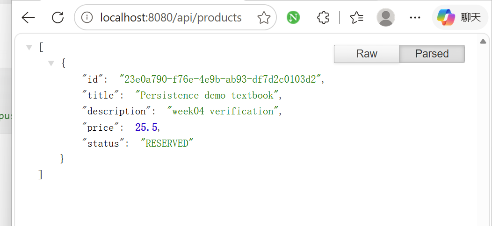
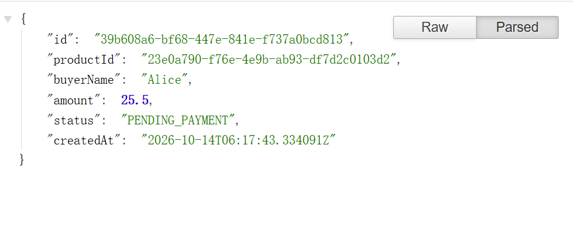
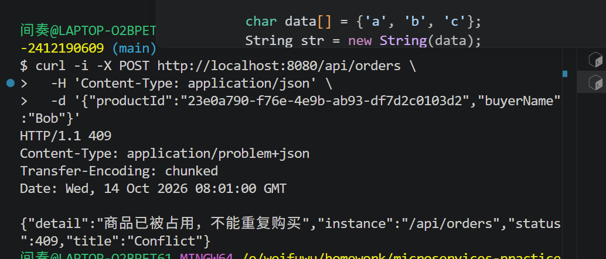
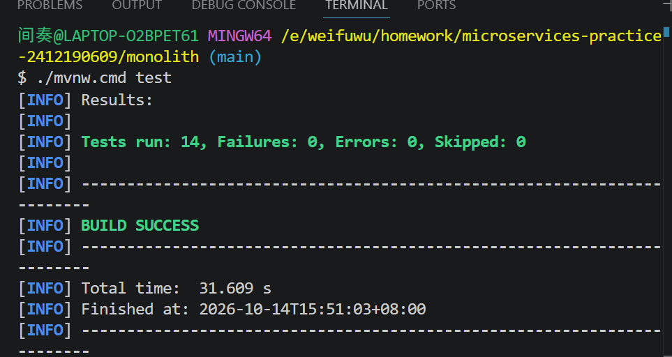
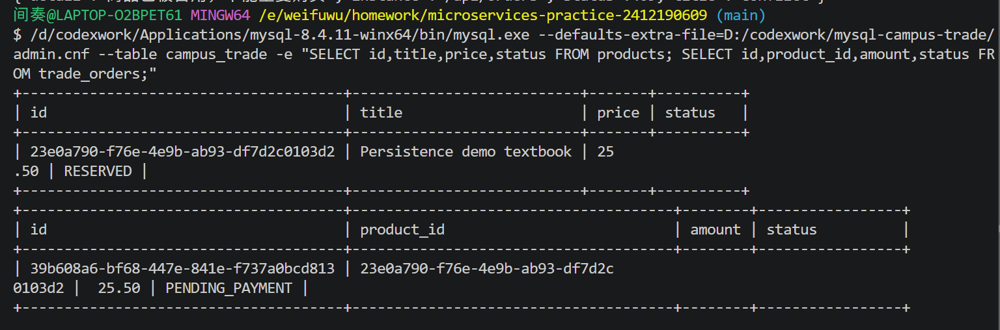

# 第四周：单体应用与数据库持久化

项目：校园二手交易与担保履约平台；包名：com.zjgsu.cyy。

## 业务建模

沿用原仓库 monolith，流程为发布商品 → 查询商品 → 下单 → 保存订单并占用商品。
两个实体为 Product、TradeOrder，订单通过外键关联商品，并保存下单时价格。当前每个商品至多一笔订单，尚未实现订单取消与重新销售。
Service 检查商品名称、价格合法性，以及只有 AVAILABLE 商品可被购买；重复购买返回 409。
详细规划见 [project-proposal.md](../../project-proposal.md)，表结构见 [database.md](../../database.md)。

## 单体应用实现

Controller 接收 DTO、调用 Service 并构造响应；Service 处理规则和事务；Repository 使用 Spring Data JPA。

| 方法 | 路由 | 成功状态 |
| --- | --- | --- |
| POST | /api/products | 201 |
| GET | /api/products | 200 |
| GET | /api/products/{id} | 200 |
| POST | /api/orders | 201 |
| GET | /api/orders/{id} | 200 |

无效输入返回 400，不存在返回 404，商品已占用返回 409。响应使用 DTO；订单金额从商品价格复制，不信任客户端传入金额。
启动：在 monolith 内配置 DB_URL、DB_USER、DB_PASSWORD 后执行 `./mvnw spring-boot:run`；Windows 为 `./mvnw.cmd spring-boot:run`。
具体 curl 示例和 D 盘缓存设置见 [README](../../../README.md)。

## 数据库持久化

实际使用 MySQL 8.4.11，独立实例监听 127.0.0.1:3307。程序、数据、日志和临时文件均位于 D 盘，原有 MySQL 8.0 未修改。
数据库 campus_trade，products 和 trade_orders 两张表；订单 product_id 外键和唯一约束保护关联及一件商品一笔订单。
下单使用 @Transactional 与商品行写锁；商品状态修改和订单写入一起提交或回滚。
2026-10-14 实际 POST 创建商品并下单成功，第二次购买返回 409；直接 SQL 查询确认两表均有数据。重启应用后 GET 商品、订单仍成功，商品为 RESERVED，订单为 PENDING_PAYMENT。
验证时临时使用 HTTP 8082，配置默认仍为 8080。数据库密码存于仓库外，通过环境变量传入。

## 测试与验证

进入 monolith：

```bash
./mvnw test
```

Windows 使用 `./mvnw.cmd test`。测试通过独立 H2 数据源自动创建表和准备数据，测试事务回滚；不依赖本机 MySQL。

| 测试类 | 数量 | 内容 |
| --- | --- | --- |
| CourseApplicationTests | 1 | Spring 上下文启动 |
| ProductServiceTests | 4 | 商品发布、价格/标题校验、不存在商品 |
| OrderServiceTests | 4 | 下单、价格快照、商品占用、重复购买、输入及不存在对象 |
| ProductControllerTests | 2 | 商品 HTTP 创建/查询、400、404 |
| OrderControllerTests | 1 | 下单 HTTP 201、订单查询、重复购买 409 |
| RepositoryTests | 2 | 数据写入并清空持久化上下文后重读、唯一约束 |

初次测试：14 项全部通过，Failures 0，Errors 0，Skipped 0，BUILD SUCCESS。
2026-10-14 15:43 再次执行仍为 14 项通过，耗时 16.383 秒。重复执行结果见 [test-result.txt](test-result.txt)；MySQL 实际验证记录见 [mysql-verification.json](mysql-verification.json)。
唯一约束测试会有预期的约束冲突日志；以最终测试汇总判断通过与否。

## 实际运行截图

以下为本机真实运行截图。订单截图展示响应内容，其请求路径及重启验证记录见上文。











尚未实现登录鉴权、支付、退款、纠纷和面交；buyerName 只用于课堂演示。
