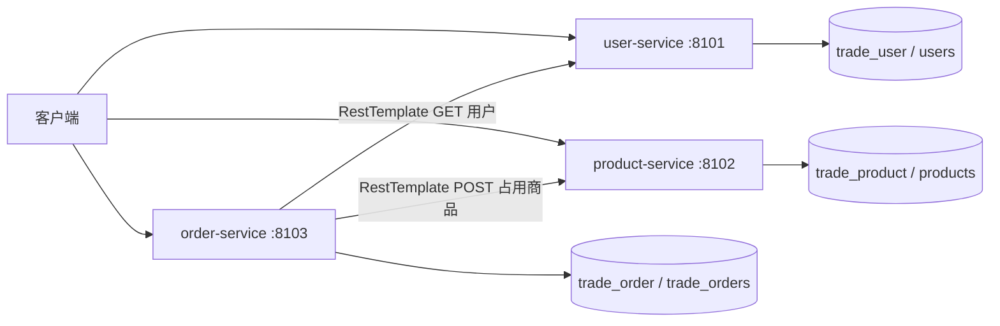

# 第六周：微服务拆分设计

本周在保留 monolith 的基础上，按已经实现的交易能力拆为用户、商品、订单三个独立服务。早期规划中的担保结算尚未实现，因此本周不建立空的支付服务。用户服务新增最小买家资料管理，将原单体订单的自由文本 buyerName 改为经 HTTP 校验的 buyerId；这是业务边界演进，不迁移或删除旧单体数据。

| 单体模块 / 能力 | 新服务 | 本机端口（容器端口） | 独立数据库 / 账号 | 拥有的表 |
| --- | --- | --- | --- | --- |
| buyerName 输入，新增买家资料 | user-service | 8101（8080） | trade_user / trade_user | users |
| Product、商品发布查询、占用规则 | product-service | 8102（8080） | trade_product / trade_product | products |
| TradeOrder、创建与查询订单 | order-service | 8103（8080） | trade_order / trade_order | trade_orders |

所有服务的基础包均为 com.zjgsu.cyy；每个服务都有独立 pom.xml、src、配置、启动类、Controller、Service、Repository、测试和 Dockerfile。

## 服务边界与数据归属

- 用户服务只管理 UUID 和姓名，提供创建、列表和详情。当前未实现注册登录和身份认证，buyerId 不等同于认证凭据。
- 商品服务管理标题、描述、价格、AVAILABLE/RESERVED 状态。商品价格必须大于零且最多两位小数；事务中的行锁保证同一商品并发占用至多成功一次。
- 订单服务通过 HTTP 校验用户并占用商品，保存 buyerId、productId、远端商品标题和价格快照、订单状态、创建时间。product_id 唯一约束保护本地重复订单。
- 每个服务仅使用自己的 Repository。跨服务只保存 ID，不建立 JPA 实体关系、跨库外键或共享 Repository。三个 MySQL 实例使用三个独立账号和命名卷，数据库端口不暴露给宿主机。

## 接口与跨服务流程

| 服务 | 接口 |
| --- | --- |
| user-service | POST /api/users；GET /api/users；GET /api/users/{id} |
| product-service | POST /api/products；GET /api/products；GET /api/products/{id}；POST /api/products/{id}/reservations |
| order-service | POST /api/orders；GET /api/orders；GET /api/orders/{id} |
| 全部服务 | GET /actuator/health |

创建用户和商品后，客户端向订单服务提交 buyerId、productId。订单服务依次 GET 用户、POST 商品占用，然后写入本地订单，返回 201。商品变为 RESERVED，订单为 PENDING_PAYMENT。金额由商品服务返回，不采信客户端金额。

RestTemplate 的地址写在 order-service 的 application.yml，通过 USER_SERVICE_URL、PRODUCT_SERVICE_URL 覆盖。连接超时默认 2000ms，读取超时默认 3000ms，可用 HTTP_CONNECT_TIMEOUT_MS、HTTP_READ_TIMEOUT_MS 覆盖。容器内使用 user-service:8080 和 product-service:8080，不使用 localhost 调用其他容器。

无效输入返回 400；依赖资源不存在返回 404；商品已占用返回 409；依赖连接失败、读取超时或服务异常返回 503；无效远端响应返回 502。依赖校验失败不会继续写入本地订单。

## 一致性边界

商品占用在商品服务本地事务中先提交，之后订单服务才写自己的数据库。如果远端占用成功而本地保存失败，会出现“商品 RESERVED、订单不存在”的窗口。读取超时也不能证明远端未执行。订单服务本地事务不能回滚远端数据库。

本周只验证顺序调用和基本失败处理，不实现分布式原子事务、自动补偿、自动重试或消息机制。遇到上述中间状态需要人工核对，后续可引入幂等请求和补偿流程。本周停止商品服务的验证发生在占用之前，不能用该结果声称已消除远端成功、本地失败窗口。

## 本地编排

根目录 compose.yaml 使用项目名 cyy-trade-week06，包含三个应用和三个 MySQL 8.4.11 容器。每个应用等待自己的数据库健康；跨服务可用性由健康检查脚本验证。应用共用 service-network，各数据库仅加入所属的 user-db/product-db/order-db 网络。

命名卷 user-data/product-data/order-data 保存数据。实际密码放在被 Git 忽略的 .env，模板 .env.example 仅提供占位值。旧 compose 保存为 compose.monolith.yaml，保留旧项目名与数据卷，不覆盖 monolith 或迁移旧数据。
