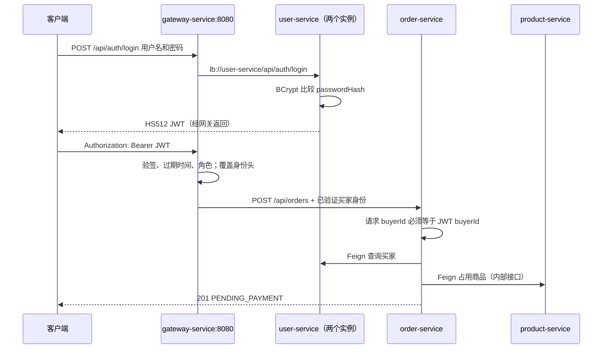

# API 网关与认证授权（Week09）

## 认证流程

## 网关路由表

|入口|目标|说明|
|---|---|---|
|`/api/auth/**`、`/api/users/**`|`lb://user-service`|登录、用户信息|
|`/api/products/**`|`lb://product-service`|商品查询与管理员发布|
|`/api/orders/**`|`lb://order-service`|本人订单、管理员查看|
|`/actuator/health`|网关本地 Actuator|公开健康检查|

路由使用 PERSONAL_GROUP 的服务名，不写容器 IP，不删除 `/api` 前缀。

## 账户和权限

|账户|角色|本地密码配置|权限|
|---|---|---|---|
|buyer|BUYER|BUYER_PASSWORD|查商品、查本人信息、创建和查看本人订单|
|buyer2|BUYER|BUYER2_PASSWORD|第二个买家，用于验证不能读取他人订单|
|admin|ADMIN|ADMIN_PASSWORD|创建商品和用户、查看所有订单；不能冒充买家下单|

密码由本地脚本随机生成，放在忽略 Git 的 `.env`。数据库只保存 BCrypt 哈希；登录响应不含密码、哈希或签名密钥。首次启动仅由 user-service 实例 1 初始化账户，重复启动不覆盖账户、不重置密码。

JWT_SECRET 为至少 64 随机字节的 Base64，user-service 与 gateway-service 通过环境变量读取。JWT 使用 HS512，包含 sub、username、role、buyerId、iat、exp，有效期 3600 秒。网关验签并校验算法、必填身份和过期时间。仓库测试里的确定性密钥只用于单元测试，运行环境不引用它。

## 鉴权与绕过防护

- 未携带、无效或过期 Token：401；密码错误：401。
- 已登录但角色或订单归属不符：403。允许的业务响应返回 JSON。
- 网关删除客户端 X-User-Id、X-Username、X-User-Role、X-Buyer-Id、X-Student-Id，仅按验签后的声明重建。
- `/api/products/{id}/reservations` 在网关拒绝所有外部角色，只有订单服务内部 Feign 可调用，防止跳过下单修改商品状态。
- 拒绝路径中的百分号编码、分号矩阵参数、双斜杠、反斜杠和点段；尾斜杠归一化后做权限判断。
- 根 compose.yaml 仅网关对外绑定 127.0.0.1:8080；用户、商品、订单及数据库均无宿主机端口，业务下游只在 Compose 网络内通信。Nacos 管理端口也仅绑定 localhost。
- 此模型信任 Docker 主机和同网络内的应用：拥有主机/Docker 管理权限的人仍可内部访问，不能声称已实现零信任。公网部署需要 HTTPS、收紧 Nacos 管理入口，以及更强的内部服务身份校验。

## 已知边界

暂未实现 Token 撤销/刷新、登录限流、分布式事务及自动补偿。商品占用是远程写操作，超时可能已成功；错误响应不代表商品回滚。测试和 Feign 不自动重试写操作。

第八周公开端口脚本是历史验证方式。本周默认关闭下游端口并增加订单权限，请使用 `scripts/auth-test.sh`，不要为运行旧脚本重新暴露下游。历史实现和证据保存在 week-08 以及对应 Git 提交。
