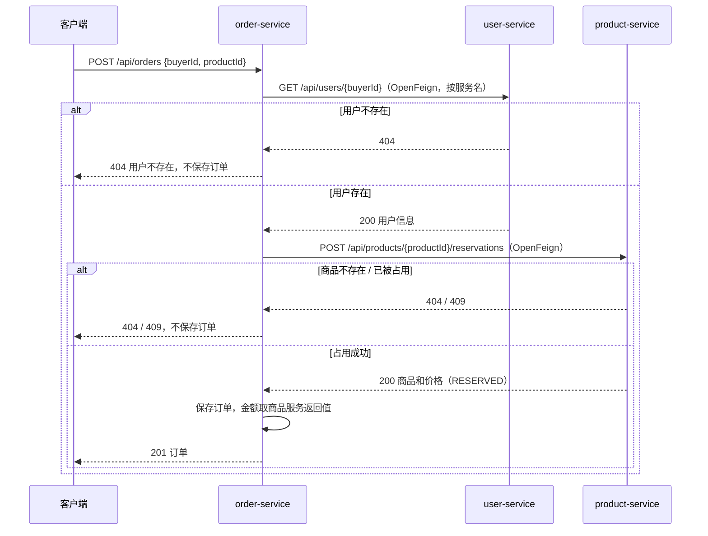

# 第八周：跨服务通信与负载均衡

## 1. 选择跨服务业务流程

选择“创建订单”作为跨服务流程。客户端只向订单服务提交买家 ID 和商品 ID，订单服务必须调用用户服务和商品服务，不能直接读它们的数据库。

### 调用链路



### 调用方、被调用方和失败位置

| 调用方 | 被调用方 | 方法 | 路径 | 失败位置和结果 |
| --- | --- | --- | --- | --- |
| 客户端 | order-service | POST | `/api/orders` | 参数错误 400 |
| order-service | user-service | GET | `/api/users/{id}` | 用户不存在 404；不可用/超时 503 |
| order-service | product-service | POST | `/api/products/{id}/reservations` | 商品不存在 404；已占用 409；不可用/超时 503 |
| order-service | 本地订单库 | — | — | 远程占用成功后本地保存失败，形成一致性窗口 |

### 服务发现和业务调用的区别

- Nacos 保存 `user-service` 和 `product-service` 的实例地址，只负责注册与发现；
- 业务 HTTP 请求由订单服务的 Feign 客户端发到实例 URI；
- Nacos 不转发业务请求，也不是 API 网关；
- 服务名来自 `spring.application.name`，分组为 `PERSONAL_GROUP`。

订单服务使用 Spring Cloud OpenFeign：

```java
@FeignClient(name = "user-service")
public interface UserFeignClient {
    @GetMapping("/api/users/{id}")
    UserView getUser(@PathVariable("id") String id);
}
```

```java
@FeignClient(name = "product-service")
public interface ProductFeignClient {
    @PostMapping("/api/products/{id}/reservations")
    ProductView reserve(@PathVariable("id") String id);
}
```

代码中没有固定容器 IP，也不再用 `RestTemplate` 拼接下游地址。

## 2. 两个 user-service 实例

`compose.yaml` 中 `user-service` 和 `user-service-2`：

- 使用同一个镜像、同一个服务名 `user-service`、同一个分组 `PERSONAL_GROUP` 和同一个用户库；
- 宿主机分别映射 8101 和 8111，避免端口冲突；
- 通过 `INSTANCE_ID` 环境变量区分实例；
- 两个实例启动后都注册到 Nacos，订单服务通过 Spring Cloud LoadBalancer 轮询选择实例。

原有访问入口 `http://localhost:8101` 仍指向第一个实例；8111 只用于第二个实例的健康检查或调试。订单服务的实际调用不写死这两个端口，而是使用 Nacos 返回的容器地址 8080。

## 3. 失败和写操作超时

- 两个 user-service 都停止后，Feign 调用失败，订单服务返回 503，不保存订单；
- 商品仍保持 AVAILABLE；
- 恢复两个实例并重新注册后，再次下单返回 201。

**重要限制**：商品占用是远程写操作。如果读取超时，远端可能已经完成占用；本地报错只能证明本地没有写订单，不能证明远端一定回滚。本项目没有分布式事务、自动补偿或自动重试，不能宣称跨服务写操作具有原子性。
